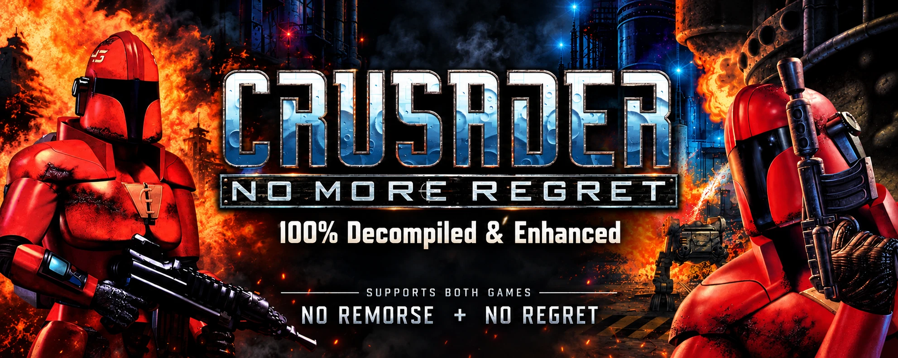

# No More Regret: No Remorse/No Regret Decompile/Enhanced Port

[English](README.md) | 한국어

Origin Systems의 DOS 게임 Crusader: No Remorse(1995)와 Crusader: No Regret(1996)를 현대 C++(C++20)와 SDL 3으로 옮긴 포트입니다. 프로그램 하나(`crusader-port`)가 두 게임을 모두 실행합니다.

- 리눅스와 macOS(Apple Silicon)에서 빌드하고 테스트합니다. 윈도우용은 리눅스에서 MinGW-w64로 크로스 컴파일하며, 테스트는 wine에서 돌립니다.
- 게임 자료는 들어 있지 않습니다. GOG판이나 Steam판 게임이 있어야 합니다([실행](#실행)).

## 원본과 얼마나 같은가

- 게임 코드는 원본 실행 파일을 함수 하나하나 옮긴 것입니다. 원본은 No Regret 1.06의 `REGRET.EXE`, No Remorse 1.21의 `CRUSADER.EXE`입니다. 사람, 문, 발판, 탄, usecode(게임 자료에 든 스크립트)가 원본과 같은 규칙으로 움직입니다. 세이브도 원본과 같은 형식이라 원본의 세이브를 그대로 불러올 수 있습니다.
- 합성 장면 테스트를 구성하고, 그 대부분이 원본에서도 같게 동작하는 것을 확인했습니다(아래 [테스트](#테스트)).

## 원본의 버그

포트는 원본의 버그 가운데 확실한 것을 고칩니다. 고친 자리에는 원본이 어떻게 했는지 코드 주석으로 적어 두었습니다. 지금까지 고친 것은 30가지 남짓입니다.

- 이미 출력된 사운드를 바로 다시 재생하면 효과음 채널을 잃고, 임의의 효과음을 재생합니다.
- `CRUSADER.CFG`가 없거나 그 안에 `flicpath` 줄이 없으면 동영상 경로를 빈 포인터에서 읽습니다.
- 잘못되거나 다른 버전의 세이브를 그대로 읽습니다.
- NPC와 사일런서가 바짝 붙었을 때, 쏠지 비켜설지가 스택에 남은 임의의 값으로 정해집니다.
- No Remorse의 경우 동영상 5편이 끝에서 멈춰 키를 기다림, 자막이 뒤로 갈수록 늦어지고 두 줄이 빠짐
- No Remorse의 경우 '다음 아이템'이 마지막 칸으로 가지 않음
- No Remorse의 경우 조이스틱의 사격 버튼을 놓을 때 '눌림'을 한 번 더 보냄 등.

버그인지 그 게임의 특징인지 가르기 어려운 동작은 원본대로 둡니다. 고친 것 전체와, 두 게임을 같게 맞춘 것, 원본대로 둔 것은
[`docs/BUGFIXES.ko.md`](docs/BUGFIXES.ko.md)에 있습니다.

### 알려진 버그(아직 고치지 않음)

아래는 모두 원본에도 있고 원인은 밝혀 두었고 대부분은 합성 테스트로 재현되어 있습니다. 1과 2는 추후 수정될 예정이며, 3과 4는 수정할지 정하지 않았습니다.

1. No Remorse, No Regret: PL-1을 마우스로 쏘면 연사가 멈추지 않음
   - 사일런서가 쏘는 중이면 마우스 버튼을 떼도 인식하지 않음
   - 따라서 No Regret은 모든 에너지를 사용할 때까지 연사되고 No Remorse는 무제한으로 연사합니다.
   - 키보드로 쏘면 놓는 순간 멈춥니다.
2. No Remorse: 드물게 다른 맵으로 순간이동한 뒤 사일런서가 사라짐
   - 기지의 텔레포트 패드로 미션 2에 갈 때 발생함. 화면은 같은 방으로 돌아오고 사일런서는 등장하지 않음
3. No Regret Mission 7에서 벽이나 바닥이 다른 위치로 이동함
   - 13번 맵의 watch station으로 레일 받침을 켠 채 엘리베이터로 14번 맵에 가면 발생함.
   - 받침을 움직이던 usecode가 맵이 바뀌어도 끝나지 않고, 14번 맵에서 같은 아이템 번호를 받은 물체를 받침의 출발점으로 옮깁니다.
   - 무엇이 옮겨지는지는 플레이 때마다 달라지며, 벽이 사라질 수도 있음
4. No Regret에서 무릎 꿇은 채 스파이더 봄을 쓰면 폭탄의 방향을 바꿀 수 없음
   - 폭탄을 조종하는 동안 조준선이 숨겨지는데, 무릎 꿇은 사일런서는 조준선이 없으면 돌지 못해 폭탄의 방향도 바꾸지 못합니다.
   - No Remorse는 폭탄을 조종하는 동안에도 조준선을 보여 줍니다.

## 두 게임의 차이

두 게임은 엔진이 거의 같아서, 포트는 게임 코드를 한 번만 두고 게임마다 데이터만 따로 관리합니다.

- 한쪽 원본에만 있던 작은 버그나 어색한 동작은 나은 쪽의 코드로 맞췄습니다. 대부분 플레이에서 눈에 띄지 않는 것들입니다.
- 게임 설계는 바꾸지 않고, 성격이 드러나는 차이는 게임마다 원본대로 둡니다.
   - No Regret에만 있는 앞구르기 등

## 포트의 기능

### 화면

- 창 모드/전체 화면 모드: Alt+Enter로 변경 가능. `enhanced.cfg`에 `fullscreen=1`이 있으면 전체 화면으로 시작합니다.
- 화면비: 원본처럼 4:3으로, 혹은 실험 기능으로 와이드 화면(WIDE (TEST))을 지원합니다. 밸런스 문제로 DIM을 추가했는데 원래 화면 밖인 양옆을 어둡게 처리합니다.

### 소리와 동영상

사운드 모듈 `ASYLUM.DLL`(Asylum Sound System), No Regret의 비디오 디코더 `XANDRV32.DLL` 재구현. 사운드나 영상에 문제가 있는 경우 대부분은 구현 실수이므로 알려주세요.

- 8비트/16비트 출력: 설정 화면의 SOUND에서 고릅니다. 8비트는 원본의 8비트 믹스를 16비트와 같은 크기로 냅니다.
- 동영상 자막 설정: 설정 화면의 SUBTITLES로 켜고 끕니다. 원본은 `CRUSADER.CFG`의 `subtitles=`로만 바꿀 수 있었습니다.

### 게임 속도

원본은 기계가 빠를수록 걷기, 달리기, 사람, 발판이 빨라졌습니다. 설정의 GAME SPEED를 통해 이 부분을 간단히 지원합니다. 기준은 No Remorse의 Mission 14에서 빠듯한 발판을 탈 수 있느냐로 정합니다.

| 값 | 무엇과 같은가 |
|---|---|
| SLOW | 느린 머신. DOSBox의 cycles 6000쯤입니다. Mission 14의 발판을 정상적으로 탑승하지 못합니다. |
| NORMAL(기본값) | No Remorse 미션 14의 발판에 보통 달리기로 탈 수 있는 가장 느린 빠르기입니다. 걷기가 FAST의 약 90%입니다 |
| FAST | 빠른 머신. DOSBox의 cycles 14000 정도와 같고, 대부분의 YouTube 영상에서 진행되는 속도입니다 |

- 바뀌는 것: 걷기와 달리기, NPC의 움직임, usecode가 한 걸음씩 기다리는 것(문이 열리는 속도, 발판의 이동, 스파이더 봄의 걸음).
- 바뀌지 않는 것: usecode의 타이머(예: 발판이 기다리는 4초).

### 조작

- 키 설정 화면: 설정의 CONTROLS에서 SETTINGS를 눌러 설정 가능
  - 이동, 키패드, 무기, 아이템, 게임 다섯 카테고리를 제공합니다.
  - 보통 게임처럼 각 액션을 선택하면 입력을 기다리고, 받은 입력을 추가 바인딩합니다. 우클릭(입력을 기다리는 동안에는 Esc도)은 그 액션의 바인딩을 모두 삭제합니다.
- 프리셋: 기본 설정과 MODERN으로 이름 붙인 현대화 조작 추가
  - ORIGINAL: 원본의 키 그대로입니다. 마우스는 원본처럼 동작합니다.
  - MODERN: WASD로 이동, Ctrl+A, Ctrl+D로 좌우 구르기, 마우스 왼쪽 버튼으로 쏘고, 오른쪽 버튼으로 무기를 듭니다. 자세한 내용은 설정 화면에서 참고하세요.
- MOUSE ROLL: 키 설정 화면에 있습니다. 켜면(기본값) 원본처럼 Ctrl을 누른 채 마우스를 움직여 구릅니다. 끄면 마우스 이동으로는 구르기를 하지 않고, 구르기 키로만 구르기를 할 수 있습니다.
- 구르기 키: 좌우 구르기는 원본처럼 Insert와 Page Up이 기본이고, MODERN에는 Ctrl+A와 Ctrl+D도 있습니다. No Regret의 앞구르기에는 따로 키를 지정할 수 있습니다(기본값 없음). 원본처럼 구르기 키와 앞으로 키를 함께 눌러도 앞구르기를 합니다.
- 게임패드: 처음 연결된 게임패드 하나를 씁니다. 기본 배치는 키 설정 화면에서 볼 수 있습니다.

### 언어

- 영어와 한국어. 설정의 LANGUAGE에서 고르거나, 게임 폴더의 `enhanced.cfg`에 `language=ko`를 적습니다.
   - 번역을 추가하거나 고치는 법은 [`port/lang/README.md`](port/lang/README.md)(영어)에 있습니다.
   - 용어집과 등장인물의 말투, 두 게임의 줄거리는 [`port/lang/ko`](port/lang/ko)에 있습니다.
   - 언어 추가는 언제든 환영합니다.
- 그림으로 된 글은 원본 그대로입니다.
- 한글은 Galmuri9 폰트로 그립니다.

### 그 밖의 것

- 세이브: `SAVEGAME/`에 원본 형식으로 씁니다. GOG판이나 Steam판의 DOSBox도 같은 폴더를 함께 쓸 수 있습니다.
- 설정 파일이 없을 때: `CRUSADER.CFG`가 없으면 GOG 설치 프로그램이 쓰는 기본값으로 시작합니다.
- 멈췄을 때: 창 위에 게임이 멈췄다는 메시지와 보고서의 위치를 띄웁니다. 까닭은 보고서(`regret-crash-*.log`,
  `remorse-crash-*.log`)와 `regret.log`/`remorse.log`에 남습니다.
- 개발용 기능: 되감기, 상태 저장, 녹화와 재생 등. 기본으로 꺼져 있으며, [`docs/DEBUG_FEATURES.ko.md`](docs/DEBUG_FEATURES.ko.md)에 있습니다.

## 실행

포트는 GOG판으로 테스트합니다: Crusader: No Regret 1.06, Crusader: No Remorse 1.21. Steam판도 파일이 같고, CD 이미지의 이름만 `GAME.BIN`입니다.

1. 게임을 설치합니다.
   - Steam판: 여느 게임처럼 설치합니다.
   - GOG판, 윈도우: GOG 설치 프로그램을 씁니다.
   - GOG판, 리눅스나 macOS: 윈도우용 설치 파일을 `innoextract`로 풉니다(macOS는 `brew install innoextract`).

     ```sh
     innoextract -d ~/games/no-remorse setup_crusader_no_remorse_1.21_*.exe
     ```
2. `crusader-port`(윈도우는 `crusader-port.exe`)를 게임 폴더의 `REGRET.EXE`나 `CRUSADER.EXE` 옆에 복사합니다.
   - 폴더에 있는 실행 파일이 어느 게임을 할지 정합니다.
   - 포트는 세이브와 설정을 이 폴더에 씁니다. 쓰기가 막힌 폴더에는 두지 마세요.
3. 실행합니다.
   - CD는 폴더의 CD 이미지를 그 자리에서 읽습니다. GOG판은 `GAME.GOG`, 없으면 Steam판의 `GAME.BIN`입니다.
   - 다른 CD(디렉터리나 이미지)를 쓰려면 환경 변수 `CRUSADER_CD`로 알려 줍니다.
   - 실행 파일의 버전이 1.06이나 1.21이 아니면 시작할 때 표준 오류에 경고를 씁니다. 창으로만 실행하면 이 경고는 보이지 않습니다.

포트가 게임 폴더에 쓰는 파일은 다음과 같습니다.

| 파일 | 내용 |
|---|---|
| `SAVEGAME/` | 세이브(원본 형식) |
| `CRUSADER.CFG` | 원본의 설정. 원본이 읽고 쓰는 그대로입니다 |
| `enhanced.cfg` | 포트의 설정: 마지막에 한 게임(`game=`), 언어(`language=`), 소리의 비트 수(`sound_bits=`), 전체 화면(`fullscreen=`), 와이드 화면(`widescreen=`), 게임 속도(`game_speed=`), 개발용 기능(`debug_feature=`), 키 프리셋(`keys=`), MOUSE ROLL(`mouse_roll=`), 동작마다의 입력(`bind_<동작>=`) |
| `regret.log`, `remorse.log` | 창으로 실행할 때 멈춘 까닭과 알림 |
| `regret-crash-*.log`, `remorse-crash-*.log` | 멈췄을 때의 보고서 |

### 포트의 키

게임의 키는 원본 그대로입니다. 포트에서는 아래 키를 추가합니다.

| 키 | 하는 일 |
|---|---|
| Alt+Enter | 전체 화면 켜고 끄기 |
| Ctrl+F10 | 마우스를 놓아 줍니다. 창을 클릭하면 다시 잡습니다 |
| F2(게임 중), 또는 주 메뉴의 OPTIONS | 설정 화면 |

### 설정 화면

원본의 옵션 화면을 개선합니다. 원본의 설정과 포트의 설정이 함께 있고, 닫을 때 `CRUSADER.CFG`와 포트 추가 설정 `enhanced.cfg`를 기록합니다.

- 원본의 설정: ANIMATIONS, FRAME SKIP, VIDEO, LIMIT BLASTS, HI COLOR VIDEO(No Regret) 또는 DIGITAL FILTERING(No Remorse), SOUND VOLUME, MUSIC VOLUME, MOUSE RESPONSE
- 포트의 설정: SUBTITLES(자막), WIDE (TEST)(와이드 화면), LANGUAGE(언어), CONTROLS(키 설정 화면), SOUND(8비트, 16비트), GAME SPEED(게임 속도)

### 명령줄

- `--game regret` 또는 `--game remorse`: 할 게임을 정합니다. 이것이 없으면 폴더의 실행 파일로 정하고, 실행 파일도 없으면 `enhanced.cfg`에 남은 마지막 게임, 그것도 없으면 No Remorse입니다.
- `--version`: 포트의 이름과 버전을 출력합니다.
- 그 밖의 인자(`-warp`, `-egg`, `-skill` 등)는 원본의 명령줄처럼 게임에 넘어갑니다.

## 추가 예정 기능

- libretro와 WebAssembly: 이후 개발은 이를 목표로 진행합니다.
- No Remorse에서 No Regret의 앞구르기 추가: 애니메이션이 없으므로, 두 데이터를 모두 인식할 때 동작하도록 계획 중입니다.
- 버그 수정: 위에 정리한 버그와 인터넷에 정리된 대부분의 버그들을 고칩니다.
- 기타 편의 기능과 포트 버그 수정 등...

## 빌드

필요한 것:

- CMake 3.24 이상
- C++20 컴파일러: GCC 또는 Clang. CI는 Ubuntu 24.04의 GCC, Clang 20, MinGW-w64 사용. 릴리스는 GCC 13 사용
- Python 3.9 이상: CMake 구성 단계에서 필요(테스트와 생성기).
- Ninja: 아래 명령은 Ninja를 씁니다. 없으면 `-G Ninja`를 빼고 CMake의 기본 생성기를 씁니다.
- SDL 3.4: 시스템에 3.4 이상이 있으면 그것을 쓰고, 없으면 `release-3.4.16`을 내려받아 정적 라이브러리로 함께 빌드합니다.

```sh
cmake -S port -B build/port -G Ninja -DCMAKE_BUILD_TYPE=Release
cmake --build build/port --target crusader
```

프로그램은 `build/port/crusader-port`입니다. `CMAKE_BUILD_TYPE`을 주지 않으면 `RelWithDebInfo`로 빌드합니다.

### 리눅스

SDL을 함께 빌드할 때, SDL은 시스템에 헤더가 있는 것만 백엔드로 넣습니다. 창은 X11과 Wayland, 소리는 ALSA, PulseAudio, PipeWire, 게임패드는 udev입니다. Ubuntu에서 CI가 설치하는 패키지는 이렇습니다(`.github/scripts/linux-packages.sh`).

```sh
sudo apt-get install ninja-build pkg-config \
  libasound2-dev libpulse-dev libpipewire-0.3-dev \
  libx11-dev libxext-dev libxrandr-dev libxcursor-dev libxfixes-dev libxi-dev libxss-dev libxtst-dev \
  libxkbcommon-dev libwayland-dev libdecor-0-dev libdrm-dev libgbm-dev \
  libegl1-mesa-dev libgl1-mesa-dev libgles2-mesa-dev \
  libdbus-1-dev libibus-1.0-dev libudev-dev
```

### 윈도우(크로스 컴파일)

리눅스에서 MinGW-w64로 만듭니다. Ubuntu의 패키지는 `g++-mingw-w64-x86-64-win32`입니다. 만든 `crusader-port.exe`는 컴파일러의 DLL 없이 혼자 돕니다(정적 링크).

```sh
cmake -S port -B build/port-win -G Ninja --toolchain $PWD/port/cmake/mingw-w64-x86_64.cmake -DCMAKE_BUILD_TYPE=Release
cmake --build build/port-win --target crusader
```

윈도우에서 직접 빌드해 보진 않았으나 MSYS2의 MinGW-w64라면 문제 없어 보입니다. MSVC는 구조체 배치가 달라 지원하지 않습니다.

### macOS(Apple Silicon)

Xcode 명령줄 도구의 Apple clang과 Homebrew로 빌드합니다.

```sh
xcode-select --install
brew install cmake ninja
cmake -S port -B build/port -G Ninja -DCMAKE_BUILD_TYPE=Release -DFETCHCONTENT_TRY_FIND_PACKAGE_MODE=NEVER
cmake --build build/port --target crusader
```

- `-DFETCHCONTENT_TRY_FIND_PACKAGE_MODE=NEVER`는 SDL을 늘 함께 빌드해 정적으로 넣습니다. 이 옵션을 빼면 Homebrew의 `sdl3`가 있을 때 그것을 동적으로 링크하므로, 만든 프로그램은 Homebrew의 SDL이 깔린 맥에서만 돕니다.
- clang-format 20이 필요한 테스트를 돌리려면 `brew install llvm@20`을 하고 `export PATH="$(brew --prefix llvm@20)/bin:$PATH"`를 합니다.

### CMake 옵션

| 옵션 | 하는 일 |
|---|---|
| `-DFETCHCONTENT_TRY_FIND_PACKAGE_MODE=NEVER` | 시스템의 SDL이 있어도 SDL을 함께 빌드합니다 |
| `-DPORT_WINDOW=OFF` | 창 없이 빌드합니다. 스크립트와 녹화 재생으로만 돕니다(새니타이저 CI가 씁니다) |
| `-DPORT_WERROR=OFF` | 경고를 오류로 다루지 않습니다. 아직 시험하지 않은 컴파일러용입니다 |
| `-DPORT_BOUNDARY_CHECK=OFF` | 게임의 경계 검사를 끕니다. 디버깅하며 게임 코드에 `printf`를 잠깐 넣을 때용입니다 |

## 테스트

테스트의 구성, 보관된 결과를 다시 쓰는 법, 원본 프로그램과의 대조를 붙이는 법은 [`port/test/README.md`](port/test/README.md)
(영어)에 있습니다.

```sh
cmake -S port -B build/port -G Ninja
cmake --build build/port
ctest --test-dir build/port -j8                   # 가진 자료로 할 수 있는 모든 테스트
ctest --test-dir build/port -L regret             # 한 게임의 것(라벨: common, regret, remorse)
ctest --test-dir build/port -R synth --output-on-failure
```

테스트는 세 층입니다.

| 층 | 필요한 것 | 테스트 |
|---|---|---|
| 1. 게임 자료 없이 | 없음 | 단위 테스트, 코드 점검, 합성 장면(32개) |
| 2. 게임 자료로 | 가진 게임의 CD 파일을 `cd/`에 | 메뉴, 미션, 동영상의 프레임, 두 언어의 단말기, 소리, 스냅숏, 되감기, 녹화(1층을 합쳐 73개) |
| 3. 원본과 대조 | 원본 프로그램과 그 함수들의 위치 표(저장소 밖) | 포트가 원본과 함수마다, 패스마다 같게 도는지 |

- 합성 장면: 게임의 것을 하나도 쓰지 않고 만든 맵, 셰이프, usecode입니다. 포트가 장면을 끝까지 두 번 플레이하고, 두 번이 같은지, 장면의 시험마다 남긴 흔적이 있는지 보고, 그 상태를 `port/test/synth/expected`에 보관된 결과와 비교합니다.
- 게임 자료로 하는 테스트: 가진 게임의 CD 파일을 `cd/noregret`과 `cd/noremorse`에 두면([`cd/README.md`](cd/README.md), 영어) CMake가 이 테스트들을 더합니다. usecode 점검, 정해진 입력으로 진행하는 메뉴와 미션, 동영상의 프레임, 두 언어의 단말기, 스냅숏 등이고, 모두 `port/<game>/test/expected`에 보관된 결과와 비교합니다. 보관된 결과는 화면, 상태, 소리, 세이브의 다이제스트(SHA-256)뿐이라 거기서 게임 자료를 만들 수 없습니다.
- 테스트는 게임 속도 SLOW에서 돕니다. 보관된 결과가 그 빠르기에서 나온 것이기 때문입니다. clang-format 20이 필요한 테스트는 셋입니다: `format`, `unified_values_current`, `text`.

GitHub Actions에서 도는 것은 다음과 같습니다.

| 워크플로 | 언제 | 하는 일 |
|---|---|---|
| CI | 모든 푸시와 PR | 리눅스 GCC 빌드와 1층 테스트, 윈도우 MinGW-w64 빌드와 wine에서의 1층 테스트 |
| Sanitizers and clang-tidy | master 푸시와 PR | Clang 20의 ASan/UBSan 빌드와 1층 테스트, 모든 코드에 clang-tidy |
| Release | `v<버전>` 태그 | 리눅스 x64와 윈도우 x64 프로그램을 만들고 테스트한 뒤 릴리스 초안을 만듭니다 |

## 코드

디렉터리마다 무엇이 들어 있는지는 [`port/README.ko.md`](port/README.ko.md)에 있습니다.

- 두 게임의 차이는 `#ifdef` 같은 전처리기로 나누지 않습니다. 프로그램 하나가 실행 중에 게임을 고르기 때문입니다.
  - 게임 코드는 모두 `port/common/src`에 한 번만 둡니다. 게임마다 다른 동작도 이 코드 안에서 게임별 값으로 갈립니다.
  - 게임별 값은 각 게임의 트리(`port/regret/src`, `port/remorse/src`)의 `<name>_game.h`에 있습니다. 게임마다 다른 표와
    자료(usecode 인트린직 표, 세이브의 배치, 키의 기본값, 번역 등)도 각 게임의 트리에 있습니다.
  - `tools/make_unified_values.py`가 두 게임의 값을 실행 중에 고르는 헤더를 `port/unified/src`에 씁니다.
  - `tools/overlay.py --check`(ctest `overlay`)가 이 규칙을 지킵니다.
- 게임 코드는 호스트(파일, 표준 출력, 환경 변수, 시계)에 `port/platform`의 함수로만 닿습니다. 빌드가 프로그램을 링크하기 전에 `tools/boundary.py`로 이것을 검사하고, 어기면 빌드가 멈춥니다([`port/README.ko.md`](port/README.ko.md)의 "게임의 경계").
- C++ 파일은 `python3 port/tools/format.py`로 맞춥니다. clang-tidy 20의 고침을 적용한 뒤 clang-format 20을 돌립니다. `git config core.hooksPath port/tools/hooks`를 하면 커밋 전마다 검사합니다.
- 도구들은 [`port/tools/README.md`](port/tools/README.md)(영어)에 있습니다.

## 라이선스

코드와 저장소의 나머지는 MIT 라이선스를 따릅니다([`LICENSE`](LICENSE)).
한글 지원을 위한 Galmuri9 폰트는 SIL Open Font License 1.1을 따릅니다: `port/common/fonts/ko.png`와 이것으로 만든 `port/common/src/text/hangul_glyphs.cpp`([`port/common/fonts/OFL.md`](port/common/fonts/OFL.md)).

이 프로젝트는 Origin Systems나 Electronic Arts와 관계가 없습니다. 게임과 그 자료의 권리는 각 권리자에게 있습니다.
