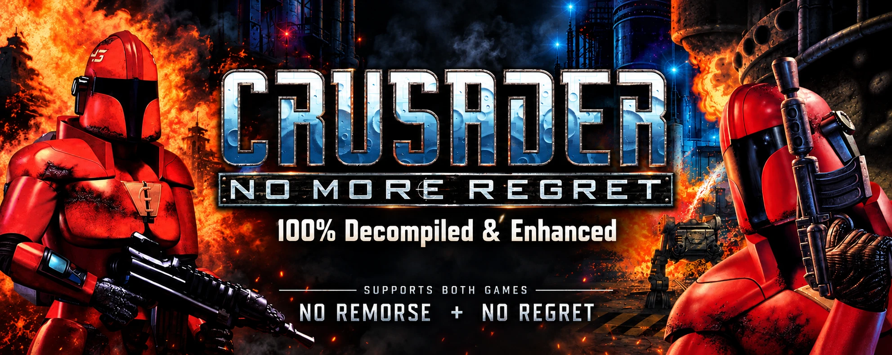

# No More Regret: No Remorse/No Regret Decompile/Enhanced Port

English | [한국어](README.ko.md)

A port of Origin Systems' DOS games Crusader: No Remorse (1995) and Crusader: No Regret (1996) to modern C++ (C++20)
and SDL 3. One program (`crusader-port`) runs both games.

- It is built and tested on Linux and macOS (Apple Silicon). The Windows build is cross-compiled on Linux with
  MinGW-w64 and tested under wine.
- No game data is included: you need the GOG or Steam release of the games ([Running](#running)).

## How close to the originals

- The game code follows the original executables function by function: No Regret 1.06's `REGRET.EXE` and No Remorse
  1.21's `CRUSADER.EXE`. People, doors, lifts, shots and usecode (the scripts in the game data) follow the same rules
  as in the originals. Saves are in the originals' format, so the originals' saves load as they are.
- The tests include synthetic scenes, and most of them were confirmed to run the same way in the originals (see
  [Tests](#tests)).

## The originals' bugs

The port fixes the originals' bugs that are certain. Where it does, a comment in the code says what the original did.
About thirty have been fixed so far:

- Playing a sound again right after it had played lost an effects channel, which then played a random effect.
- Without `CRUSADER.CFG`, or without a `flicpath` line in it, the movies' path was read from a null pointer.
- Broken saves, or saves of another version, were read as they were.
- When an NPC and the Silencer stood close together, whether the NPC shot or stepped aside was decided by a value left
  on the stack.
- In No Remorse, five movies stopped at their end to wait for a key; the subtitles fell further behind as a movie went
  on, and two lines were missing.
- In No Remorse, "next item" did not reach the last slot.
- In No Remorse, letting go of the joystick's fire button sent one more press; and so on.

Behaviour that is hard to tell apart from a feature of the game is kept as in the original. The full list, with what
was made the same in both games and what was kept: [`docs/BUGFIXES.md`](docs/BUGFIXES.md).

### Known bugs (not fixed yet)

All of these are in the originals too. Their causes are known, and most are reproduced by synthetic tests. 1 and 2
will be fixed; whether to fix 3 and 4 is not decided yet.

1. No Remorse, No Regret: the PL-1 fired with the mouse does not stop auto-firing
   - While the Silencer is firing, letting go of the mouse button is not noticed.
   - So No Regret fires until all the energy is used, and No Remorse fires without end.
   - Fired with the keyboard, it stops as soon as the key is let go.
2. No Remorse: rarely, the Silencer vanishes after teleporting to another map
   - It happened going to mission 2 by the base's teleport pad. The screen comes back to the same room, and the
     Silencer does not appear.
3. No Regret, mission 7: a wall or a floor moves somewhere else
   - It happens when you take the elevator to map 14 with the rail platform turned on from map 13's watch station.
   - The usecode that moved the platform does not end when the map changes, and in map 14 it moves the object that got
     the same item number to the platform's starting point.
   - What gets moved differs from play to play; a wall can vanish.
4. No Regret: a spider bomb used while kneeling cannot change direction
   - The reticle is hidden while the bomb is steered, and a kneeling Silencer cannot turn without the reticle, so the
     bomb cannot turn either.
   - No Remorse shows the reticle while the bomb is steered too.

## The two games' differences

The two games run on nearly the same engine, so the port keeps the game code once and only each game's own data apart.

- Small bugs or awkward behaviour found in only one of the originals were made to follow the better one's code. Most
  are not noticeable in play.
- The games' design is not changed, and differences that show a game's character stay as in each original, such as
  No Regret's forward roll.

## Features of the port

### Screen

- Windowed or full screen: switch with Alt+Enter. With `fullscreen=1` in `enhanced.cfg`, the game starts in full
  screen.
- Aspect ratio: 4:3 as in the original, or the experimental wide screen (WIDE (TEST)). For balance there is also DIM,
  which darkens the sides that are off screen in the original.

### Sound and movies

The sound module `ASYLUM.DLL` (the Asylum Sound System) and No Regret's movie decoder `XANDRV32.DLL` are
reimplemented. A problem with the sound or the movies is most likely a mistake in the reimplementation, so please
report it.

- 8-bit or 16-bit output: chosen under SOUND in the settings. 8-bit is the original's 8-bit mix at the same level as
  16-bit.
- Movie subtitles: turned on and off under SUBTITLES in the settings. The original could change them only with
  `subtitles=` in `CRUSADER.CFG`.

### Game speed

In the originals, the faster the machine, the faster walking, running, the people and the lifts went. GAME SPEED in
the settings gives a simple choice of it. The measure is whether a tight lift in No Remorse's mission 14 can be
boarded.

| Value | What it matches |
|---|---|
| SLOW | A slow machine: about DOSBox's cycles 6000. The mission 14 lift cannot be boarded normally |
| NORMAL (default) | The slowest speed at which an ordinary run boards No Remorse's mission 14 lift. Walking is about 90% of FAST |
| FAST | A fast machine: about DOSBox's cycles 14000, the speed seen in most YouTube videos |

- What changes: walking and running, the NPCs' movement, and usecode's step-by-step waits (doors opening, lifts
  moving, the spider bomb's steps).
- What does not change: usecode's timers (for example, a lift's 4-second wait).

### Controls

- Key settings screen: CONTROLS, then SETTINGS, in the settings
  - The actions come in five groups: movement, keypad, weapons, items and game.
  - As in most games, choosing an action waits for an input, which is added to the action's bindings. A right click
    (or Esc while waiting for an input) clears all of the action's bindings.
- Presets: the default, and a modern layout named MODERN
  - ORIGINAL: the original's keys as they were; the mouse works as in the original.
  - MODERN: WASD to move, Ctrl+A and Ctrl+D to roll left and right; the left mouse button fires and the right one
    readies the weapon. See the settings screen for the rest.
- MOUSE ROLL: on the key settings screen. On (the default), moving the mouse with Ctrl held rolls, as in the original.
  Off, moving the mouse never rolls; only the roll keys do.
- Roll keys: the side rolls are Insert and Page Up by default, as in the original, and MODERN adds Ctrl+A and Ctrl+D.
  No Regret's forward roll can have a key of its own (none by default). As in the original, a roll key with the
  forward key also rolls forward.
- Gamepad: the first gamepad connected is used. Its default layout is shown on the key settings screen.

### Languages

- English and Korean: choose under LANGUAGE in the settings, or put `language=ko` in the game folder's `enhanced.cfg`.
  - How to add or fix a translation: [`port/lang/README.md`](port/lang/README.md).
  - The glossary, the characters' ways of speaking and both games' stories: [`port/lang/ko`](port/lang/ko) (in
    Korean).
  - New languages are always welcome.
- Text drawn in pictures stays as in the original.
- Hangul is drawn with the Galmuri9 font.

### Other

- Saves: written to `SAVEGAME/` in the original's format. The DOSBox of the GOG or Steam release can share the same
  folder.
- Without a settings file: without `CRUSADER.CFG`, the game starts with the defaults GOG's installer writes.
- When it halts: a message box over the window says the game stopped and where the report is. The cause is in the
  report (`regret-crash-*.log`, `remorse-crash-*.log`) and in `regret.log`/`remorse.log`.
- Debug features: rewind, saved states, recording and replay, and more. They are off by default; see
  [`docs/DEBUG_FEATURES.md`](docs/DEBUG_FEATURES.md).

## Running

The port is tested with the GOG releases: Crusader: No Regret 1.06 and Crusader: No Remorse 1.21. The Steam releases
hold the same files; only the CD image is named `GAME.BIN`.

1. Install the game.
   - Steam: install it as any game.
   - GOG on Windows: use GOG's installer.
   - GOG on Linux or macOS: unpack the Windows installer with `innoextract` (on macOS, `brew install innoextract`).

     ```sh
     innoextract -d ~/games/no-remorse setup_crusader_no_remorse_1.21_*.exe
     ```
2. Copy `crusader-port` (`crusader-port.exe` on Windows) into the game's folder, beside `REGRET.EXE` or
   `CRUSADER.EXE`.
   - The executable in the folder chooses the game.
   - The port writes its saves and settings in this folder, so do not put it in one you cannot write to.
3. Run it.
   - The CD is read in place from the folder's CD image: GOG's `GAME.GOG`, else Steam's `GAME.BIN`.
   - To use another CD (a directory or an image), name it with the environment variable `CRUSADER_CD`.
   - When the game's executable is not version 1.06 or 1.21, the port writes a warning to the standard error as it
     starts. Run without a terminal, the warning is not seen.

The port writes these files in the game's folder:

| File | What it holds |
|---|---|
| `SAVEGAME/` | Saves (the original's format) |
| `CRUSADER.CFG` | The original's settings, as the original reads and writes them |
| `enhanced.cfg` | The port's settings: the last game played (`game=`), the language (`language=`), the sound's bits (`sound_bits=`), full screen (`fullscreen=`), the wide screen (`widescreen=`), the game speed (`game_speed=`), the debug features (`debug_feature=`), the keys' preset (`keys=`), MOUSE ROLL (`mouse_roll=`), each action's inputs (`bind_<action>=`) |
| `regret.log`, `remorse.log` | Why a run with a window halted, and its notices |
| `regret-crash-*.log`, `remorse-crash-*.log` | The report of a halt |

### The port's keys

The game's keys are the original's. The port adds these:

| Key | What it does |
|---|---|
| Alt+Enter | Full screen on and off |
| Ctrl+F10 | Frees the mouse; a click on the window takes it again |
| F2 (in the game), or OPTIONS in the main menu | The settings screen |

### The settings screen

It improves on the original's options screen. It holds the original's settings and the port's, and writes
`CRUSADER.CFG` and the port's own `enhanced.cfg` as it closes.

- The original's settings: ANIMATIONS, FRAME SKIP, VIDEO, LIMIT BLASTS, HI COLOR VIDEO (No Regret) or DIGITAL
  FILTERING (No Remorse), SOUND VOLUME, MUSIC VOLUME, MOUSE RESPONSE
- The port's settings: SUBTITLES, WIDE (TEST) (the wide screen), LANGUAGE, CONTROLS (the key settings screen), SOUND
  (8-bit, 16-bit), GAME SPEED

### Command line

- `--game regret` or `--game remorse`: the game to play. Without it, the executable in the folder chooses; without
  one, the last game in `enhanced.cfg`; without that, No Remorse.
- `--version`: prints the port's name and version.
- Other arguments (`-warp`, `-egg`, `-skill` and so on) go to the game, as on the original's command line.

## Planned

- libretro and WebAssembly: further development aims at these.
- No Regret's forward roll in No Remorse: No Remorse has no animation for it, so it is planned to work when the data
  of both games are found.
- Bug fixes: the bugs above, and most of the bugs listed around the internet.
- Other conveniences, fixes of the port's own bugs, and so on.

## Building

Requirements:

- CMake 3.24 or later
- A C++20 compiler: GCC or Clang. CI uses Ubuntu 24.04's GCC, Clang 20 and MinGW-w64; releases are built with GCC 13
- Python 3.9 or later: needed when CMake configures (the tests and the generators)
- Ninja: the commands below use it. Without it, leave out `-G Ninja` for CMake's default generator
- SDL 3.4: a system SDL of 3.4 or later is used; without one, `release-3.4.16` is fetched and built along as a static
  library

```sh
cmake -S port -B build/port -G Ninja -DCMAKE_BUILD_TYPE=Release
cmake --build build/port --target crusader
```

The program is `build/port/crusader-port`. Without `CMAKE_BUILD_TYPE`, it builds `RelWithDebInfo`.

### Linux

When SDL is built along, it takes in only the backends whose headers the system has: X11 and Wayland for the window,
ALSA, PulseAudio and PipeWire for the sound, udev for gamepads. These are the packages CI installs on Ubuntu
(`.github/scripts/linux-packages.sh`):

```sh
sudo apt-get install ninja-build pkg-config \
  libasound2-dev libpulse-dev libpipewire-0.3-dev \
  libx11-dev libxext-dev libxrandr-dev libxcursor-dev libxfixes-dev libxi-dev libxss-dev libxtst-dev \
  libxkbcommon-dev libwayland-dev libdecor-0-dev libdrm-dev libgbm-dev \
  libegl1-mesa-dev libgl1-mesa-dev libgles2-mesa-dev \
  libdbus-1-dev libibus-1.0-dev libudev-dev
```

### Windows (cross-compiling)

Built on Linux with MinGW-w64; Ubuntu's package is `g++-mingw-w64-x86-64-win32`. The `crusader-port.exe` it makes runs
on its own, without the compiler's DLLs (linked statically).

```sh
cmake -S port -B build/port-win -G Ninja --toolchain $PWD/port/cmake/mingw-w64-x86_64.cmake -DCMAKE_BUILD_TYPE=Release
cmake --build build/port-win --target crusader
```

Building on Windows itself has not been tried, but MSYS2's MinGW-w64 looks fine. MSVC is not supported: it lays out
the structures differently.

### macOS (Apple Silicon)

Built with the Apple clang of the Xcode command line tools and Homebrew:

```sh
xcode-select --install
brew install cmake ninja
cmake -S port -B build/port -G Ninja -DCMAKE_BUILD_TYPE=Release -DFETCHCONTENT_TRY_FIND_PACKAGE_MODE=NEVER
cmake --build build/port --target crusader
```

- `-DFETCHCONTENT_TRY_FIND_PACKAGE_MODE=NEVER` always builds SDL along and links it statically. Without it, a Homebrew
  `sdl3` is linked dynamically, and the program runs only on Macs that have Homebrew's SDL installed.
- For the tests that need clang-format 20: `brew install llvm@20`, then
  `export PATH="$(brew --prefix llvm@20)/bin:$PATH"`.

### CMake options

| Option | What it does |
|---|---|
| `-DFETCHCONTENT_TRY_FIND_PACKAGE_MODE=NEVER` | Builds SDL along even when the system has one |
| `-DPORT_WINDOW=OFF` | Builds without a window: the program runs only scripts and replays (the sanitizer CI's build) |
| `-DPORT_WERROR=OFF` | Leaves warnings as warnings: for a compiler not yet tried |
| `-DPORT_BOUNDARY_CHECK=OFF` | Turns the game's boundary check off: for a `printf` put into the game code for a while when debugging |

## Tests

How the tests are laid out, how their kept results are written again and how the comparison with the original
programs plugs in: [`port/test/README.md`](port/test/README.md).

```sh
cmake -S port -B build/port -G Ninja
cmake --build build/port
ctest --test-dir build/port -j8                   # every test the data at hand allows
ctest --test-dir build/port -L regret             # one game's (labels: common, regret, remorse)
ctest --test-dir build/port -R synth --output-on-failure
```

The tests come in three layers:

| Layer | What it needs | Tests |
|---|---|---|
| 1. Without the game data | Nothing | Unit tests, checks of the code, synthetic scenes (32) |
| 2. With the game data | Your copies' CD files in `cd/` | Menus, missions, the movies' frames, the terminals in both languages, the sound, snapshots, the rewind, recordings (73 with layer 1) |
| 3. Against the originals | The original programs and the table of their functions' places (outside the repository) | Whether the port runs as the originals, function by function and pass by pass |

- Synthetic scenes: maps, shapes and usecode made from nothing of the games'. The port plays each scene to its end
  twice, checks that the two runs are the same and that each of the scene's checks left its trace, and compares the
  state with the results kept in `port/test/synth/expected`.
- Tests on the game data: with your copies' CD files in `cd/noregret` and `cd/noremorse` ([`cd/README.md`](cd/README.md)),
  CMake adds these tests: the usecode's checks, menus and missions played from scripted input, the movies' frames, the
  terminals in both languages, snapshots and more, each compared with the results kept in `port/<game>/test/expected`.
  The kept results are only digests (SHA-256) of the screen, the state, the sound and the saves, so no game data can
  be made from them.
- The tests run at the game speed SLOW, the speed their kept results came from. Three tests need clang-format 20:
  `format`, `unified_values_current` and `text`.

What runs on GitHub Actions:

| Workflow | When | What it does |
|---|---|---|
| CI | Every push and pull request | The Linux GCC build and layer 1; the Windows MinGW-w64 build and layer 1 under wine |
| Sanitizers and clang-tidy | Pushes to master and pull requests | The Clang 20 ASan/UBSan build and layer 1; clang-tidy on all the code |
| Release | A `v<version>` tag | Builds and tests the Linux x64 and Windows x64 programs, then drafts a release |

## Code

What each directory holds: [`port/README.md`](port/README.md).

- The two games' differences are not split with the preprocessor, such as `#ifdef`: one program chooses its game at
  run time.
  - All the game code is in `port/common/src`, once. Behaviour that differs between the games is chosen in that code
    by per-game values.
  - The per-game values are in `<name>_game.h` in each game's tree (`port/regret/src`, `port/remorse/src`). The tables
    and data that differ (the usecode intrinsics' table, the saves' layout, the keys' defaults, the translations and
    so on) are in each game's tree too.
  - `tools/make_unified_values.py` writes the headers that choose between the two games' values at run time, in
    `port/unified/src`.
  - `tools/overlay.py --check` (ctest `overlay`) keeps to this rule.
- The game code reaches the host (files, the standard output, environment variables, the clock) only through the
  functions of `port/platform`. Before the program links, the build checks this with `tools/boundary.py`, and a
  breach stops the build ("The game's boundary" in [`port/README.md`](port/README.md)).
- C++ files are formatted with `python3 port/tools/format.py`: clang-tidy 20's fixes first, then clang-format 20.
  `git config core.hooksPath port/tools/hooks` checks them before every commit.
- The tools: [`port/tools/README.md`](port/tools/README.md).

## License

The code and the rest of the repository are under the MIT License ([`LICENSE`](LICENSE)). The Galmuri9 font used for
Hangul is under the SIL Open Font License 1.1: `port/common/fonts/ko.png` and `port/common/src/text/hangul_glyphs.cpp`,
made from it ([`port/common/fonts/OFL.md`](port/common/fonts/OFL.md)).

This project is not affiliated with Origin Systems or Electronic Arts. The games and their data belong to their
owners.
